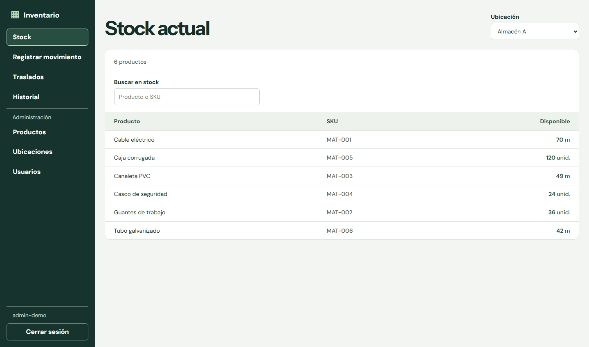
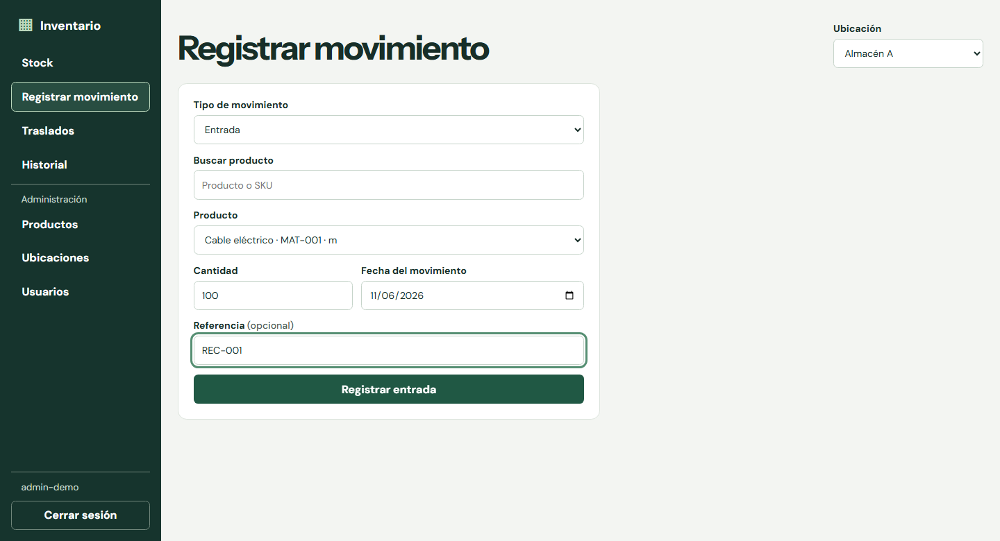
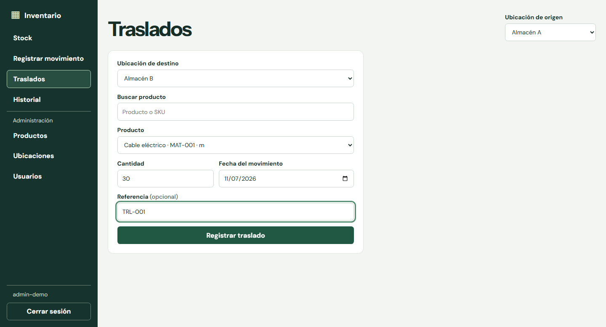
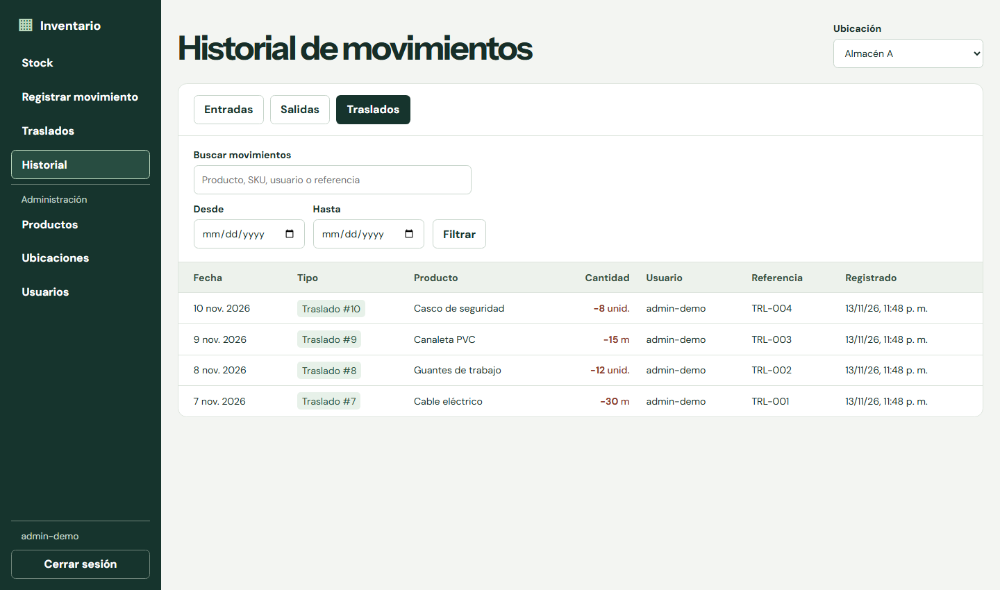
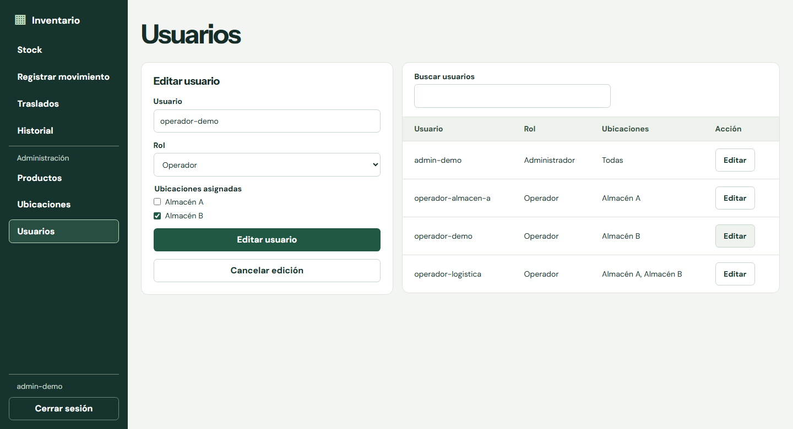

# Gestión de Inventario

Kardex para empresas que necesitan saber cuánto stock tienen en cada ubicación y qué movimientos explican ese saldo. El proyecto parte de un flujo común que puede adaptarse a cada operación.

## Primera versión

- Acceso para administradores y operadores, con permisos por ubicación.
- Catálogo de productos con SKU, unidad de medida y categoría.
- Registro de saldo inicial, entradas, salidas y traslados.
- Consulta de stock actual e historial por ubicación.

La primera versión parte de que el saldo del sistema coincide con el inventario físico. Los movimientos representan operaciones reales y las salidas requieren saldo suficiente.

## Documentación

| Documento | Contenido |
|---|---|
| [Instalación local](docs/instalacion-local.md) | Dependencias, PostgreSQL, migraciones y arranque. |
| [Requerimientos](docs/requerimientos.md) | Alcance, matriz de permisos y criterios de aceptación. |
| [Casos de uso](docs/casos-de-uso.md) | Flujos de administración, registro de movimientos y consulta. |
| [Arquitectura](docs/arquitectura.md) | Componentes, modelo conceptual de datos, secuencia de un traslado y estrategia de pruebas. |

## Capturas del sistema

Las capturas muestran la aplicación en ejecución local con datos ficticios.

### Consultar existencias

El menú lateral separa **Stock**, **Registrar movimiento**, **Traslados** e **Historial**. Los administradores también tienen acceso directo a **Productos**, **Ubicaciones** y **Usuarios**. Las tablas muestran 20 filas por página.

### Registrar y trasladar stock

En **Registrar movimiento** se anotan entradas, salidas y saldos iniciales. Para mover stock entre almacenes, **Traslados** permite elegir el origen, el destino y la cantidad.

Ver el registro de una entrada

Ver el formulario de traslado

### Revisar el historial

En **Historial**, elige **Entradas**, **Salidas** o **Traslados**. La vista de Entradas incluye los saldos iniciales. En las tres vistas puedes buscar por producto, SKU, usuario o referencia y acotar los resultados por fecha.

### Administrar accesos

Desde **Usuarios**, un administrador puede cambiar el rol de una cuenta y asignar a cada operador los almacenes donde puede trabajar.

Ver la asignación de almacenes a un operador

## Probar la aplicación

Sigue la [guía de instalación local](docs/instalacion-local.md) para levantar Flask y PostgreSQL y cargar los datos ficticios.

### Recorrido de inventario

Abre `http://127.0.0.1:5000` e inicia sesión como `admin-demo` con la contraseña que elegiste al cargar los datos. En una base nueva, usa el producto **Cable eléctrico** para recorrer los tres movimientos.

| Operación | Almacén A | Almacén B |
|---|---:|---:|
| Registrar una entrada de 100 m en A | 100 m | 0 m |
| Trasladar 30 m de A a B | 70 m | 30 m |
| Registrar una salida de 10 m en B | 70 m | 20 m |

Usa **Registrar movimiento** para la entrada y la salida, y **Traslados** para mover material entre almacenes. En **Historial**, abre la vista **Traslados** para comprobar que el movimiento tiene el mismo identificador en ambos almacenes. En A aparece como −30 m y en B como +30 m. Una salida de 21 m desde B debe rechazarse y conservar el saldo de 20 m. Con `operador-demo` puedes operar en B. Para registrar un traslado necesitas acceso a dos ubicaciones.

### Preparar tu propio catálogo

Con la cuenta de administrador, abre **Productos** en el menú lateral. Crea un producto con SKU, nombre, unidad y categoría, y agrega un almacén desde **Ubicaciones**. Abre **Registrar movimiento**, selecciona el nuevo almacén y registra una entrada del producto para consultar su saldo e historial.

Puedes cambiar el nombre de un almacén y editar los datos del producto desde sus listas. La unidad de medida se puede corregir hasta el primer movimiento del producto.

### Asignar acceso a un almacén

Abre **Usuarios** en el menú lateral. Crea un operador con una contraseña de al menos 12 caracteres y marca **Almacén A**. Inicia sesión con esa cuenta en otra ventana y registra una entrada. Desde la cuenta de administrador, edita el operador, desmarca A y marca B. Al volver a la ventana del operador, la lista de ubicaciones se actualiza. Las siguientes consultas y movimientos ya usan la nueva asignación, incluso con la sesión abierta.

El rol administrador da acceso a todas las ubicaciones. Las asignaciones individuales se aplican al rol operador.

## Pruebas

[GitHub Actions](https://github.com/steveespinoza/GESTION-DE-INVENTARIO/actions/workflows/ci.yml) compila React, ejecuta las pruebas de Flask y reproduce el recorrido de inventario en Chromium. Los trabajos se ejecutan en los PR hacia `main` y en los cambios que llegan a esa rama, con bases PostgreSQL 17 temporales.

La suite comprueba permisos por ubicación, consistencia entre saldo e historial, descuentos concurrentes y el efecto de un fallo durante un traslado. La prueba de navegador recorre la entrada, el traslado y la salida desde la interfaz. Para ejecutarlas en tu equipo, consulta [Ejecutar las pruebas](docs/instalacion-local.md#ejecutar-las-pruebas).
