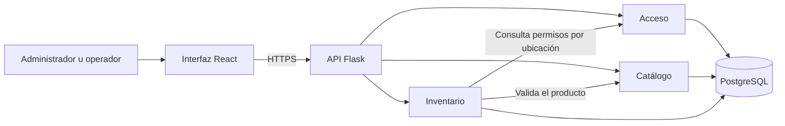
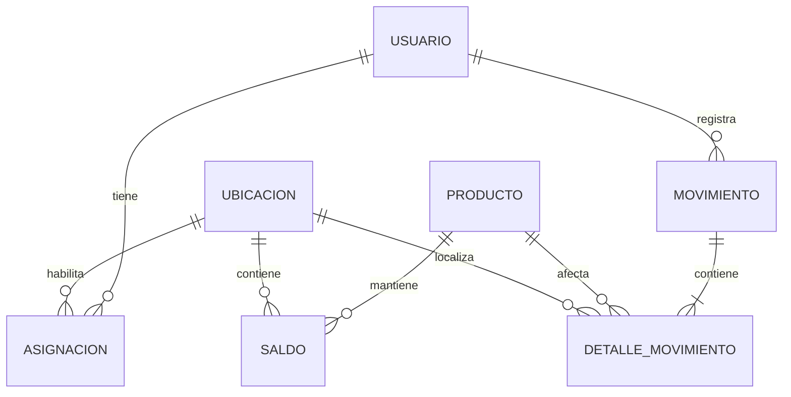
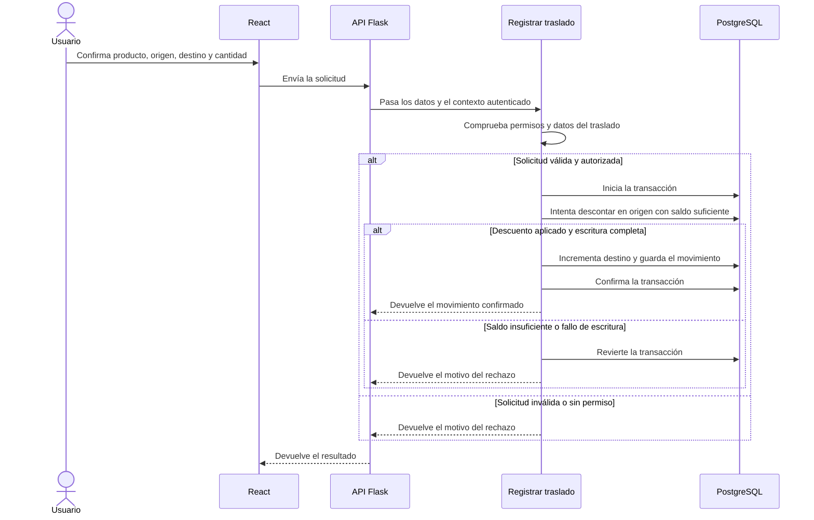

# Arquitectura propuesta

Propongo un monolito modular con React, Flask y PostgreSQL. Quiero mantener un solo despliegue de la API y aprovechar una transacción de base de datos para confirmar los movimientos y los saldos.

## Componentes

| Módulo | Responsabilidad |
|---|---|
| Acceso | Autenticar al usuario, administrar roles y asignaciones, y comprobar el acceso por ubicación. |
| Catálogo | Administrar productos, SKU, unidades de medida y categorías. |
| Inventario | Administrar ubicaciones, registrar movimientos, mantener saldos y ofrecer consultas de stock e historial. |

Las rutas Flask traducen las solicitudes a casos de uso. Los casos de uso coordinan permisos, reglas del negocio y persistencia. Los adaptadores ejecutan las operaciones en PostgreSQL. Inventario es el único módulo que modifica los saldos.

## Modelo conceptual de datos

Cada detalle representa una variación de un producto en una ubicación. Una entrada o salida tiene una variación por producto afectado. Un traslado tiene una variación negativa en el origen y una positiva en el destino, asociadas al mismo movimiento. El saldo tiene una clave única por producto y ubicación.

El modelo muestra las relaciones del núcleo. El esquema físico definirá tipos, restricciones, precisión e índices cuando se detalle la persistencia.

## Secuencia de un traslado

## Estrategia de pruebas

- **Unitarias.** Validar cantidades, decisiones de permisos y reglas de movimientos sin iniciar Flask.
- **Integración con PostgreSQL.** Comprobar SKU único, saldos bajo concurrencia y confirmación o reversión completa de una transacción de traslado.
- **Extremo a extremo.** Recorrer desde la interfaz una entrada, un traslado y una salida. Comparar los saldos con el historial. [Recorrido de aceptación](casos-de-uso.md#recorrido-de-aceptación)

## Despliegue de referencia

Planeo ejecutar React en Vercel, Flask en Render y PostgreSQL en Neon. La aplicación debe poder ejecutarse localmente con una base separada y datos ficticios para la demo y las pruebas.
